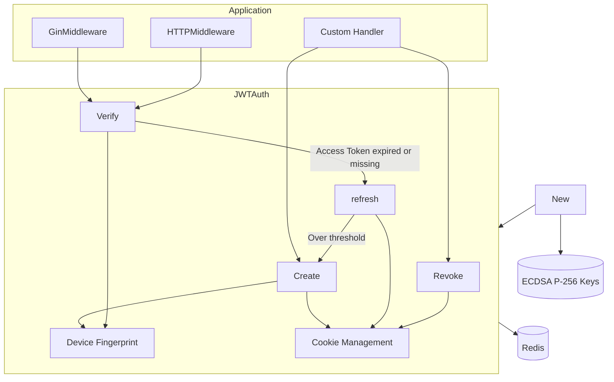

# Architecture

This page shows how go-jwt's layers relate in a single diagram; per-module flows, sequence diagrams, and the state machine live in [doc/architecture.md](https://github.com/pardnchiu/go-jwt/blob/main/doc/architecture.md).

## System Overview

## Layers

| Layer | Components | Files | Responsibility |
|---|---|---|---|
| Integration | `GinMiddleware`, `HTTPMiddleware`, `GetAuthDataFromGinContext`, `GetAuthDataFromHTTPRequest` | `core/middleware.go` | Call `Verify`; respond with a JSON error on failure, put `*Auth` into the context on success |
| Lifecycle | `Create`, `Verify`, `refresh`, `Revoke` | `core/create.go`, `core/verify.go`, `core/refresh.go`, `core/revoke.go` | Issue, verify, refresh, revoke |
| Binding | `getFingerprint`, `getAccessToken`, `getRefreshID` | `core/utility.go`, `core/refreshData.go` | Extract credentials and the device fingerprint from the request |
| Delivery | `setCookie`, `clearCookie` | `core/cookie.go` | Write or clear cookies according to `Config.Cookie` |
| Initialization | `New`, `handlePEM`, `parsePEM` | `core/instance.go`, `core/pem.go` | Apply defaults, load or generate keys, connect to Redis |
| State | Redis | — | Refresh data, JTI whitelist, revocation records, refresh locks |

## Cross-Cutting Principles

| Principle | Implementation |
|---|---|
| Check server state beyond the signature | After ES256 verification, an Access Token is valid only while `jti:<jti>` exists in Redis |
| Bind credentials to the device | The Access Token `fp` claim and the `fp` in Redis refresh data must both equal the fingerprint computed for this request |
| Never split multi-key writes | Issue, refresh, and revoke send their Redis writes in one `TxPipeline` (`MULTI`/`EXEC`) |
| Refresh a Refresh ID once at a time | A 3-second `SETNX lock:refresh:<id>` lock, released by a Lua script that `DEL`s only when the holder matches |
| Results instead of errors | Every lifecycle method returns `JWTAuthResult`, distinguishing causes by `StatusCode`/`ErrorTag` |

## Dependencies

| Module | Version (`go.mod`) | Used for |
|---|---|---|
| `github.com/golang-jwt/jwt/v5` | v5.2.2 | ES256 signing (`jwt.SigningMethodES256`) and parsing with signature, `exp`, and `nbf` validation; go-jwt adds the Refresh ID, fingerprint, JTI whitelist, refresh, and revocation on top |
| `github.com/redis/go-redis/v9` | v9.8.0 | All session state, `TxPipeline` writes, and the unlock `EVAL` |
| `github.com/gin-gonic/gin` | v1.10.1 | `GinMiddleware()` and `GetAuthDataFromGinContext()` |

### Related Go JWT Packages

Other Go JWT packages, quoted from their GitHub descriptions (2026-10-21); the right column describes only go-jwt's own behavior.

| Package | Description (GitHub) | go-jwt |
|---|---|---|
| `appleboy/gin-jwt` | JWT Middleware for Gin framework | Serves both Gin (`GinMiddleware`) and `net/http` (`HTTPMiddleware`); refresh runs inside `Verify`, so there is no refresh endpoint to call |
| `auth0/go-jwt-middleware` | A Middleware for Go Programming Language to check for JWTs on HTTP requests | Also issues (`Create`) and revokes (`Revoke`) tokens, and requires the `jti` to exist in Redis after the signature check |
| `go-chi/jwtauth` | JWT authentication middleware for Go HTTP services | Binds every Access Token to a device fingerprint and to a Refresh ID whose data lives in Redis |
| `lestrrat-go/jwx` | Complete implementation of JWx (JOSE) technologies for Go | Signs only ES256 and covers the login session lifecycle: issue, verify, refresh, revoke |

## Further Reading

- [Token Model](/core-concepts)
- [Verification Flow](/verification)
- [Transparent Refresh](/refresh)
- [Redis Keys](/redis-keys)
