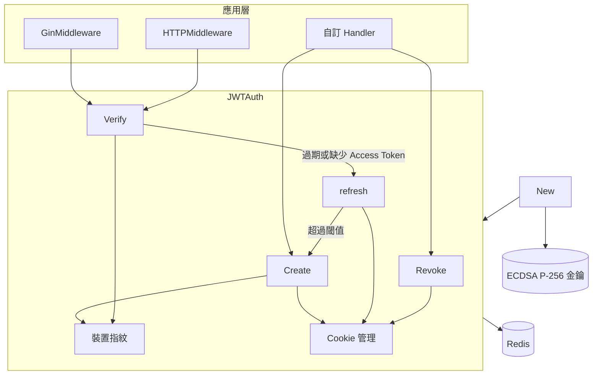

# 架構

本頁以一張圖說明 go-jwt 各層的關係；模組內部流程、序列圖與狀態機見 [doc/architecture.zh.md](https://github.com/pardnchiu/go-jwt/blob/main/doc/architecture.zh.md)。

## 系統概覽

## 分層

| 層 | 元件 | 檔案 | 職責 |
|---|---|---|---|
| 整合 | `GinMiddleware`、`HTTPMiddleware`、`GetAuthDataFromGinContext`、`GetAuthDataFromHTTPRequest` | `core/middleware.go` | 呼叫 `Verify`，失敗回 JSON error，成功把 `*Auth` 放進 context |
| 生命週期 | `Create`、`Verify`、`refresh`、`Revoke` | `core/create.go`、`core/verify.go`、`core/refresh.go`、`core/revoke.go` | 簽發、驗證、刷新、撤銷 |
| 綁定 | `getFingerprint`、`getAccessToken`、`getRefreshID` | `core/utility.go`、`core/refreshData.go` | 從請求取出憑證與裝置指紋 |
| 傳遞 | `setCookie`、`clearCookie` | `core/cookie.go` | 依 `Config.Cookie` 寫入或清除 Cookie |
| 初始化 | `New`、`handlePEM`、`parsePEM` | `core/instance.go`、`core/pem.go` | 套用預設值、載入或產生金鑰、連線 Redis |
| 狀態 | Redis | — | 刷新資料、JTI 白名單、撤銷紀錄、刷新鎖 |

## 跨切原則

| 原則 | 實作 |
|---|---|
| 簽章之外再查伺服器狀態 | Access Token 通過 ES256 驗章後，仍須 `jti:<jti>` 存在於 Redis 才算有效 |
| 憑證綁定裝置 | Access Token 的 `fp` claim 與 Redis 刷新資料的 `fp` 都必須等於本次請求算出的指紋 |
| 多筆寫入不拆開 | 簽發、刷新、撤銷的 Redis 寫入都以 `TxPipeline`（`MULTI`／`EXEC`）一次送出 |
| 同一 Refresh ID 同時只刷新一次 | `SETNX lock:refresh:<id>` 3 秒鎖，解鎖以 Lua 比對持有者後才 `DEL` |
| 以結果物件回報 | 生命週期方法一律回傳 `JWTAuthResult`，以 `StatusCode`／`ErrorTag` 區分原因 |

## 相依套件

| 模組 | 版本（`go.mod`） | 用途 |
|---|---|---|
| `github.com/golang-jwt/jwt/v5` | v5.2.2 | ES256 簽署（`jwt.SigningMethodES256`）與解析，含簽章、`exp`、`nbf` 驗證；go-jwt 在其上加入 Refresh ID、裝置指紋、JTI 白名單、刷新與撤銷 |
| `github.com/redis/go-redis/v9` | v9.8.0 | 所有 session 狀態、`TxPipeline` 寫入與解鎖 `EVAL` |
| `github.com/gin-gonic/gin` | v1.10.1 | `GinMiddleware()` 與 `GetAuthDataFromGinContext()` |

### 其他 Go JWT 套件

以下引用各套件的 GitHub 描述（2026-10-21）；右欄只說明 go-jwt 自身的行為。

| 套件 | 描述（GitHub） | go-jwt |
|---|---|---|
| `appleboy/gin-jwt` | JWT Middleware for Gin framework | 同時提供 Gin（`GinMiddleware`）與 `net/http`（`HTTPMiddleware`）中介層；刷新在 `Verify` 內完成，不需要另外呼叫刷新端點 |
| `auth0/go-jwt-middleware` | A Middleware for Go Programming Language to check for JWTs on HTTP requests | 也負責簽發（`Create`）與撤銷（`Revoke`），並在簽章驗證後要求 `jti` 存在於 Redis |
| `go-chi/jwtauth` | JWT authentication middleware for Go HTTP services | 每個 Access Token 綁定裝置指紋，以及資料存於 Redis 的 Refresh ID |
| `lestrrat-go/jwx` | Complete implementation of JWx (JOSE) technologies for Go | 只簽 ES256，涵蓋登入 session 的完整生命週期：簽發、驗證、刷新、撤銷 |

## 延伸閱讀

- [Token 模型](/zh/core-concepts)
- [驗證流程](/zh/verification)
- [透明刷新](/zh/refresh)
- [Redis Key](/zh/redis-keys)
